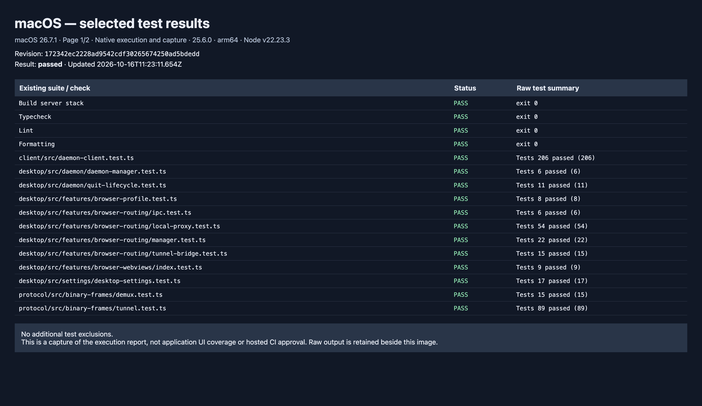
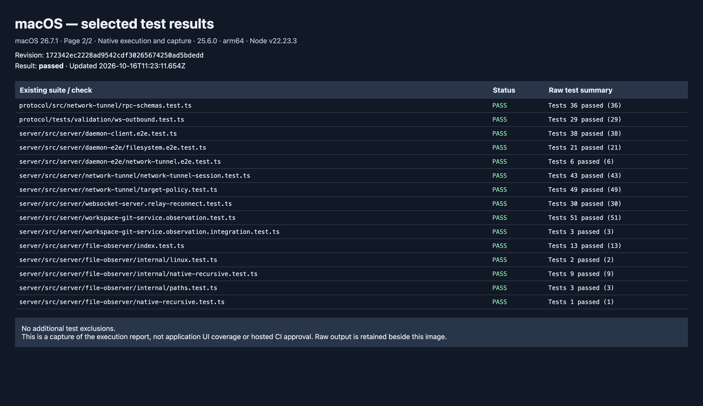
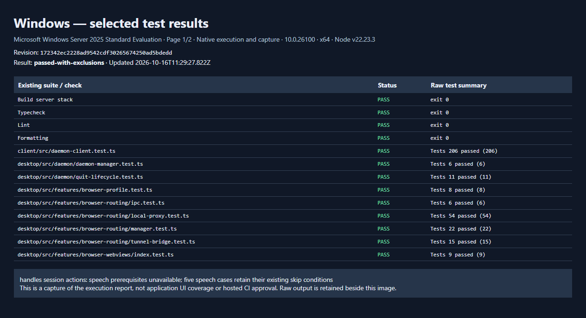
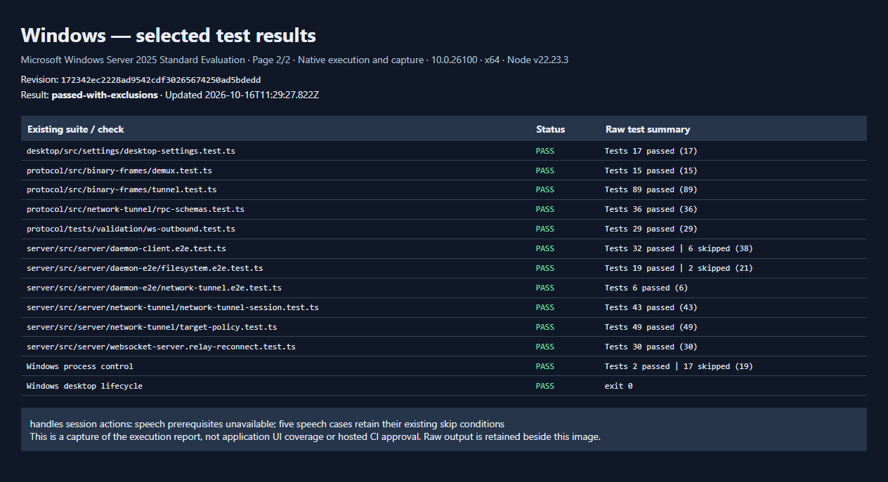

# Desktop platform validation

Revision: `172342ec2228ad9542cdf30265674250ad5bdedd`. Base: `8d9a7123ba38353029352a93a85cca7160af6f07`.

Selected existing suites ran serially on real macOS and a Windows Server 2025 evaluation VM. These results do not replace hosted CI or desktop routing UI coverage. Screenshots show the saved execution report captured by Electron on each tested operating system.

## macos

792 tests passed in 27 files. Build, typecheck, lint and formatting passed. Node v22.23.3, arm64; completed 2026-10-16T11:23:11.654Z.





<details><summary>Commands and raw result summaries</summary>

```text
$ npm run build:server
Exit: 0

$ npm run typecheck
Exit: 0

$ npm run lint
Exit: 0

$ npm run format:check
Exit: 0

$ npx --no-install vitest run packages/client/src/daemon-client.test.ts --bail=1 --maxWorkers=1
Exit: 0
 Test Files  1 passed (1)
      Tests  206 passed (206)
   Duration  3.94s (transform 2.19s, setup 0ms, import 2.50s, tests 1.37s, environment 0ms)

$ npx --no-install vitest run packages/desktop/src/daemon/daemon-manager.test.ts --bail=1 --maxWorkers=1
Exit: 0
 Test Files  1 passed (1)
      Tests  6 passed (6)
   Duration  852ms (transform 121ms, setup 0ms, import 232ms, tests 552ms, environment 0ms)

$ npx --no-install vitest run packages/desktop/src/daemon/quit-lifecycle.test.ts --bail=1 --maxWorkers=1
Exit: 0
 Test Files  1 passed (1)
      Tests  11 passed (11)
   Duration  129ms (transform 31ms, setup 0ms, import 57ms, tests 4ms, environment 0ms)

$ npx --no-install vitest run packages/desktop/src/features/browser-profile.test.ts --bail=1 --maxWorkers=1
Exit: 0
 Test Files  1 passed (1)
      Tests  8 passed (8)
   Duration  96ms (transform 21ms, setup 0ms, import 28ms, tests 4ms, environment 0ms)

$ npx --no-install vitest run packages/desktop/src/features/browser-routing/ipc.test.ts --bail=1 --maxWorkers=1
Exit: 0
 Test Files  1 passed (1)
      Tests  6 passed (6)
   Duration  202ms (transform 73ms, setup 0ms, import 115ms, tests 21ms, environment 0ms)

$ npx --no-install vitest run packages/desktop/src/features/browser-routing/local-proxy.test.ts --bail=1 --maxWorkers=1
Exit: 0
 Test Files  1 passed (1)
      Tests  54 passed (54)
   Duration  563ms (transform 59ms, setup 0ms, import 97ms, tests 398ms, environment 0ms)

$ npx --no-install vitest run packages/desktop/src/features/browser-routing/manager.test.ts --bail=1 --maxWorkers=1
Exit: 0
 Test Files  1 passed (1)
      Tests  22 passed (22)
   Duration  235ms (transform 70ms, setup 0ms, import 111ms, tests 59ms, environment 0ms)

$ npx --no-install vitest run packages/desktop/src/features/browser-routing/tunnel-bridge.test.ts --bail=1 --maxWorkers=1
Exit: 0
 Test Files  1 passed (1)
      Tests  15 passed (15)
   Duration  156ms (transform 50ms, setup 0ms, import 84ms, tests 6ms, environment 0ms)

$ npx --no-install vitest run packages/desktop/src/features/browser-webviews/index.test.ts --bail=1 --maxWorkers=1
Exit: 0
 Test Files  1 passed (1)
      Tests  9 passed (9)
   Duration  110ms (transform 34ms, setup 0ms, import 44ms, tests 3ms, environment 0ms)

$ npx --no-install vitest run packages/desktop/src/settings/desktop-settings.test.ts --bail=1 --maxWorkers=1
Exit: 0
 Test Files  1 passed (1)
      Tests  17 passed (17)
   Duration  146ms (transform 29ms, setup 0ms, import 54ms, tests 28ms, environment 0ms)

$ npx --no-install vitest run packages/protocol/src/binary-frames/demux.test.ts --bail=1 --maxWorkers=1
Exit: 0
 Test Files  1 passed (1)
      Tests  15 passed (15)
   Duration  317ms (transform 149ms, setup 0ms, import 247ms, tests 4ms, environment 0ms)

$ npx --no-install vitest run packages/protocol/src/binary-frames/tunnel.test.ts --bail=1 --maxWorkers=1
Exit: 0
 Test Files  1 passed (1)
      Tests  89 passed (89)
   Duration  238ms (transform 24ms, setup 0ms, import 31ms, tests 143ms, environment 0ms)

$ npx --no-install vitest run packages/protocol/src/network-tunnel/rpc-schemas.test.ts --bail=1 --maxWorkers=1
Exit: 0
 Test Files  1 passed (1)
      Tests  36 passed (36)
   Duration  322ms (transform 146ms, setup 0ms, import 241ms, tests 12ms, environment 0ms)

$ npx --no-install vitest run packages/protocol/tests/validation/ws-outbound.test.ts --bail=1 --maxWorkers=1
Exit: 0
 Test Files  1 passed (1)
      Tests  29 passed (29)
   Duration  2.65s (transform 1.95s, setup 0ms, import 2.20s, tests 386ms, environment 0ms)

$ npx --no-install vitest run packages/server/src/server/daemon-client.e2e.test.ts --bail=1 --maxWorkers=1 --config packages/server/vitest.config.ts
Exit: 0
 Test Files  1 passed (1)
      Tests  38 passed (38)
   Duration  49.56s (transform 4.29s, setup 19ms, import 5.34s, tests 44.13s, environment 0ms)

$ npx --no-install vitest run packages/server/src/server/daemon-e2e/filesystem.e2e.test.ts --bail=1 --maxWorkers=1 --config packages/server/vitest.config.ts
Exit: 0
 Test Files  1 passed (1)
      Tests  21 passed (21)
   Duration  10.16s (transform 4.14s, setup 18ms, import 5.13s, tests 4.94s, environment 0ms)

$ npx --no-install vitest run packages/server/src/server/daemon-e2e/network-tunnel.e2e.test.ts --bail=1 --maxWorkers=1 --config packages/server/vitest.config.ts
Exit: 0
 Test Files  1 passed (1)
      Tests  6 passed (6)
   Duration  5.69s (transform 3.91s, setup 20ms, import 4.89s, tests 711ms, environment 0ms)

$ npx --no-install vitest run packages/server/src/server/network-tunnel/network-tunnel-session.test.ts --bail=1 --maxWorkers=1 --config packages/server/vitest.config.ts
Exit: 0
 Test Files  1 passed (1)
      Tests  43 passed (43)
   Duration  2.03s (transform 182ms, setup 18ms, import 290ms, tests 1.65s, environment 0ms)

$ npx --no-install vitest run packages/server/src/server/network-tunnel/target-policy.test.ts --bail=1 --maxWorkers=1 --config packages/server/vitest.config.ts
Exit: 0
 Test Files  1 passed (1)
      Tests  49 passed (49)
   Duration  305ms (transform 133ms, setup 18ms, import 215ms, tests 8ms, environment 0ms)

$ npx --no-install vitest run packages/server/src/server/websocket-server.relay-reconnect.test.ts --bail=1 --maxWorkers=1 --config packages/server/vitest.config.ts
Exit: 0
 Test Files  1 passed (1)
      Tests  30 passed (30)
   Duration  3.88s (transform 933ms, setup 18ms, import 1.36s, tests 2.43s, environment 0ms)

$ npx --no-install vitest run packages/server/src/server/workspace-git-service.observation.test.ts --bail=1 --maxWorkers=1 --config packages/server/vitest.config.ts
Exit: 0
 Test Files  1 passed (1)
      Tests  51 passed (51)
   Duration  4.10s (transform 353ms, setup 18ms, import 469ms, tests 3.54s, environment 0ms)

$ npx --no-install vitest run packages/server/src/server/workspace-git-service.observation.integration.test.ts --bail=1 --maxWorkers=1 --config packages/server/vitest.config.ts
Exit: 0
 Test Files  1 passed (1)
      Tests  3 passed (3)
   Duration  8.26s (transform 303ms, setup 18ms, import 418ms, tests 7.75s, environment 0ms)

$ npx --no-install vitest run packages/server/src/server/file-observer/index.test.ts --bail=1 --maxWorkers=1 --config packages/server/vitest.config.ts
Exit: 0
 Test Files  1 passed (1)
      Tests  13 passed (13)
   Duration  2.29s (transform 51ms, setup 18ms, import 48ms, tests 2.16s, environment 0ms)

$ npx --no-install vitest run packages/server/src/server/file-observer/internal/linux.test.ts --bail=1 --maxWorkers=1 --config packages/server/vitest.config.ts
Exit: 0
 Test Files  1 passed (1)
      Tests  2 passed (2)
   Duration  173ms (transform 48ms, setup 18ms, import 45ms, tests 44ms, environment 0ms)

$ npx --no-install vitest run packages/server/src/server/file-observer/internal/native-recursive.test.ts --bail=1 --maxWorkers=1 --config packages/server/vitest.config.ts
Exit: 0
 Test Files  1 passed (1)
      Tests  9 passed (9)
   Duration  10.06s (transform 49ms, setup 19ms, import 46ms, tests 9.92s, environment 0ms)

$ npx --no-install vitest run packages/server/src/server/file-observer/internal/paths.test.ts --bail=1 --maxWorkers=1 --config packages/server/vitest.config.ts
Exit: 0
 Test Files  1 passed (1)
      Tests  3 passed (3)
   Duration  95ms (transform 19ms, setup 18ms, import 12ms, tests 2ms, environment 0ms)

$ npx --no-install vitest run packages/server/src/server/file-observer/native-recursive.test.ts --bail=1 --maxWorkers=1 --config packages/server/vitest.config.ts
Exit: 0
 Test Files  1 passed (1)
      Tests  1 passed (1)
   Duration  173ms (transform 39ms, setup 18ms, import 33ms, tests 56ms, environment 0ms)

```
</details>

## windows

704 tests passed in 21 files. Build, typecheck, lint and formatting passed. Node v22.23.3, x64; completed 2026-10-16T11:29:27.822Z.

Windows scope: handles session actions: speech prerequisites unavailable; five speech cases retain their existing skip conditions. Two filesystem symlink-copy cases retain their existing Windows skips. The process-control command selects two Windows-specific cases; its other 17 cases are outside this run. Desktop lifecycle E2E also passed.





<details><summary>Commands and raw result summaries</summary>

```text
$ npm run build:server
Exit: 0

$ npm run typecheck
Exit: 0

$ npm run lint
Exit: 0

$ npm run format:check
Exit: 0

$ npx --no-install vitest run packages/client/src/daemon-client.test.ts --bail=1 --maxWorkers=1
Exit: 0
 Test Files  1 passed (1)
      Tests  206 passed (206)
   Duration  5.66s (transform 2.82s, setup 0ms, import 3.94s, tests 1.42s, environment 0ms)

$ npx --no-install vitest run packages/desktop/src/daemon/daemon-manager.test.ts --bail=1 --maxWorkers=1
Exit: 0
 Test Files  1 passed (1)
      Tests  6 passed (6)
   Duration  3.12s (transform 232ms, setup 0ms, import 2.35s, tests 666ms, environment 0ms)

$ npx --no-install vitest run packages/desktop/src/daemon/quit-lifecycle.test.ts --bail=1 --maxWorkers=1
Exit: 0
 Test Files  1 passed (1)
      Tests  11 passed (11)
   Duration  222ms (transform 51ms, setup 0ms, import 116ms, tests 5ms, environment 0ms)

$ npx --no-install vitest run packages/desktop/src/features/browser-profile.test.ts --bail=1 --maxWorkers=1
Exit: 0
 Test Files  1 passed (1)
      Tests  8 passed (8)
   Duration  161ms (transform 33ms, setup 0ms, import 57ms, tests 5ms, environment 0ms)

$ npx --no-install vitest run packages/desktop/src/features/browser-routing/ipc.test.ts --bail=1 --maxWorkers=1
Exit: 0
 Test Files  1 passed (1)
      Tests  6 passed (6)
   Duration  374ms (transform 99ms, setup 0ms, import 240ms, tests 39ms, environment 0ms)

$ npx --no-install vitest run packages/desktop/src/features/browser-routing/local-proxy.test.ts --bail=1 --maxWorkers=1
Exit: 0
 Test Files  1 passed (1)
      Tests  54 passed (54)
   Duration  1.08s (transform 83ms, setup 0ms, import 189ms, tests 792ms, environment 0ms)

$ npx --no-install vitest run packages/desktop/src/features/browser-routing/manager.test.ts --bail=1 --maxWorkers=1
Exit: 0
 Test Files  1 passed (1)
      Tests  22 passed (22)
   Duration  462ms (transform 101ms, setup 0ms, import 237ms, tests 126ms, environment 0ms)

$ npx --no-install vitest run packages/desktop/src/features/browser-routing/tunnel-bridge.test.ts --bail=1 --maxWorkers=1
Exit: 0
 Test Files  1 passed (1)
      Tests  15 passed (15)
   Duration  283ms (transform 76ms, setup 0ms, import 174ms, tests 8ms, environment 0ms)

$ npx --no-install vitest run packages/desktop/src/features/browser-webviews/index.test.ts --bail=1 --maxWorkers=1
Exit: 0
 Test Files  1 passed (1)
      Tests  9 passed (9)
   Duration  226ms (transform 52ms, setup 0ms, import 113ms, tests 4ms, environment 0ms)

$ npx --no-install vitest run packages/desktop/src/settings/desktop-settings.test.ts --bail=1 --maxWorkers=1
Exit: 0
 Test Files  1 passed (1)
      Tests  17 passed (17)
   Duration  317ms (transform 43ms, setup 0ms, import 100ms, tests 119ms, environment 0ms)

$ npx --no-install vitest run packages/protocol/src/binary-frames/demux.test.ts --bail=1 --maxWorkers=1
Exit: 0
 Test Files  1 passed (1)
      Tests  15 passed (15)
   Duration  672ms (transform 224ms, setup 0ms, import 566ms, tests 4ms, environment 0ms)

$ npx --no-install vitest run packages/protocol/src/binary-frames/tunnel.test.ts --bail=1 --maxWorkers=1
Exit: 0
 Test Files  1 passed (1)
      Tests  89 passed (89)
   Duration  341ms (transform 37ms, setup 0ms, import 67ms, tests 176ms, environment 0ms)

$ npx --no-install vitest run packages/protocol/src/network-tunnel/rpc-schemas.test.ts --bail=1 --maxWorkers=1
Exit: 0
 Test Files  1 passed (1)
      Tests  36 passed (36)
   Duration  626ms (transform 225ms, setup 0ms, import 492ms, tests 18ms, environment 0ms)

$ npx --no-install vitest run packages/protocol/tests/validation/ws-outbound.test.ts --bail=1 --maxWorkers=1
Exit: 0
 Test Files  1 passed (1)
      Tests  29 passed (29)
   Duration  4.10s (transform 2.82s, setup 0ms, import 3.54s, tests 460ms, environment 0ms)

$ npx --no-install vitest run packages/server/src/server/daemon-client.e2e.test.ts --bail=1 --maxWorkers=1 --config packages/server/vitest.config.ts -t "^(?!handles session actions$)"
Exit: 0
 Test Files  1 passed (1)
      Tests  32 passed | 6 skipped (38)
   Duration  28.41s (transform 6.22s, setup 36ms, import 16.26s, tests 11.98s, environment 0ms)

$ npx --no-install vitest run packages/server/src/server/daemon-e2e/filesystem.e2e.test.ts --bail=1 --maxWorkers=1 --config packages/server/vitest.config.ts
Exit: 0
 Test Files  1 passed (1)
      Tests  19 passed | 2 skipped (21)
   Duration  18.83s (transform 5.81s, setup 37ms, import 10.52s, tests 8.17s, environment 0ms)

$ npx --no-install vitest run packages/server/src/server/daemon-e2e/network-tunnel.e2e.test.ts --bail=1 --maxWorkers=1 --config packages/server/vitest.config.ts
Exit: 0
 Test Files  1 passed (1)
      Tests  6 passed (6)
   Duration  11.07s (transform 5.32s, setup 30ms, import 10.00s, tests 937ms, environment 0ms)

$ npx --no-install vitest run packages/server/src/server/network-tunnel/network-tunnel-session.test.ts --bail=1 --maxWorkers=1 --config packages/server/vitest.config.ts
Exit: 0
 Test Files  1 passed (1)
      Tests  43 passed (43)
   Duration  2.22s (transform 252ms, setup 29ms, import 577ms, tests 1.51s, environment 0ms)

$ npx --no-install vitest run packages/server/src/server/network-tunnel/target-policy.test.ts --bail=1 --maxWorkers=1 --config packages/server/vitest.config.ts
Exit: 0
 Test Files  1 passed (1)
      Tests  49 passed (49)
   Duration  622ms (transform 217ms, setup 29ms, import 481ms, tests 11ms, environment 0ms)

$ npx --no-install vitest run packages/server/src/server/websocket-server.relay-reconnect.test.ts --bail=1 --maxWorkers=1 --config packages/server/vitest.config.ts
Exit: 0
 Test Files  1 passed (1)
      Tests  30 passed (30)
   Duration  6.27s (transform 1.43s, setup 28ms, import 3.57s, tests 2.57s, environment 0ms)

$ npx --no-install vitest run packages/cli/src/commands/daemon/lifecycle.e2e.test.ts --bail=1 --maxWorkers=1 -t "Windows unbound|managed two-home"
Exit: 0
 Test Files  1 passed (1)
      Tests  2 passed | 17 skipped (19)
   Duration  33.87s (transform 3.64s, setup 0ms, import 4.78s, tests 28.98s, environment 0ms)

$ npm run test:e2e:lifecycle --workspace=@getpaseo/desktop
Exit: 0

```
</details>
